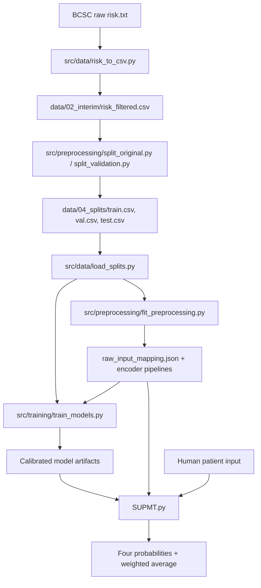
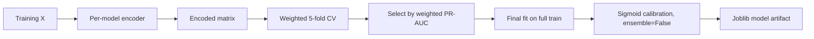
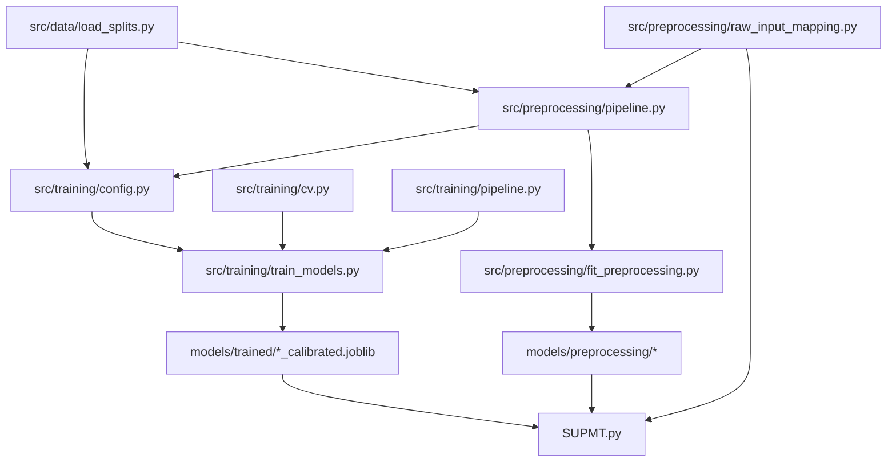

# Architecture

## Main Components

The implemented system is a research pipeline with four stages:

1. Data preparation and splitting
2. Preprocessing and encoding
3. Model training, tuning, calibration, and evaluation
4. Inference from human-readable patient input

## High-Level System Architecture

## Training Architecture

Evidence: `src/training/train_models.py`, `src/training/config.py`, `src/training/cv.py`.

## Inference Architecture

Evidence: `SUPMT.py`, `src/preprocessing/raw_input_mapping.py`, `src/preprocessing/pipeline.py`.

## Component Responsibilities

| Component | Responsibility |
|---|---|
| `src/data/load_splits.py` | Defines `FEATURES`, `TARGET`, `WEIGHT`; loads and validates splits |
| `src/preprocessing/raw_input_mapping.py` | Human/interface mapping and strict validation |
| `src/preprocessing/pipeline.py` | Encoder construction, fitting, transformation, serialization |
| `src/training/config.py` | Model specs, encoder mapping, CV/calibration policy |
| `src/training/cv.py` | Weighted folds, metrics, probability extraction |
| `src/training/train_models.py` | Training, tuning, calibration, validation evaluation |
| `SUPMT.py` | Artifact loading and inference |
| `SUPMT_CONFIG.py` | Inference weights and artifact paths |

## Training vs Inference Separation

- Training fits encoders and models on the Training split only.
- Validation is used for evaluation/comparison, not tuning/calibration.
- Inference loads saved artifacts and calls `transform`/`predict_proba` only.
- `SUPMT.py` does not fit or retrain anything.

## Component Dependencies

## Known Architecture Limitations

- No service/API layer is implemented.
- Test split was used only for one authorized final evaluation.
- `surgmeno` and `hrt` code 9 combines Unknown and Not Applicable.
- Dependency versions are not pinned in `requirements.txt`.