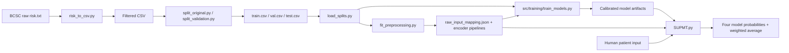

# BCSC Risk Estimation

## Project Overview

BCSC Risk Estimation is a research and engineering repository for analyzing the
Breast Cancer Surveillance Consortium (BCSC) risk estimation dataset and building
a reproducible preprocessing, training, evaluation, and inference pipeline for
breast cancer risk estimation.

The repository contains data conversion, exploratory analysis, weighted data
splitting, leakage-safe preprocessing, model training/configuration, calibration,
evaluation, a Modified Barlow Architecture experiment, and a final inference
system (`SUPMT.py`).

This is a research / proof-of-concept project. It is not a diagnostic system and
does not replace professional medical judgment.

## Current Implementation Status

Implemented and verified in the repository:

- TXT-to-CSV conversion and basic validation (`src/data/risk_to_csv.py`)
- Weighted train/validation/test split creation and loading
- Leakage audit and missing-value policy documentation
- Two-stage preprocessing:
  - interface-to-BCSC raw input mapping
  - model-specific encoders (`onehot`, `ordinal_tree`)
- Training configuration for four models
- Weighted cross-validation utilities
- Four trained and calibrated models
- Modified Barlow Architecture experiment
- One-time frozen Test evaluation artifacts
- Final inference system (`SUPMT.py`, `SUPMT_CONFIG.py`)
- Automated inference test tool (`test_SUPMT_inference.py`)

Not implemented / not in repository:

- Web/API service
- Clinical deployment workflow
- Prospective validation
- External dataset validation
- Real-time data ingestion

## High-Level Architecture



## Main Components

| Component | Location | Purpose |
|---|---|---|
| Data conversion | `src/data/risk_to_csv.py` | Converts `risk.txt` to CSV with validation |
| Split loader | `src/data/load_splits.py` | Defines `FEATURES`, `TARGET`, `WEIGHT`, loads splits |
| Split creation | `src/preprocessing/split_original.py`, `split_validation.py` | Creates train/test and train/val splits |
| Raw input mapping | `src/preprocessing/raw_input_mapping.py` | Maps interface codes and human input to BCSC codes |
| Model preprocessing | `src/preprocessing/pipeline.py` | Builds, fits, transforms, saves/loads encoders |
| Artifact fitting | `src/preprocessing/fit_preprocessing.py` | Fits preprocessing artifacts on train only |
| Training config | `src/training/config.py` | Model specs, encoder mapping, CV/calibration policy |
| Weighted CV | `src/training/cv.py` | Weighted folds, metrics, probability extraction |
| Model pipelines | `src/training/pipeline.py` | MLP scaler+model pipeline and artifact helpers |
| Model training | `src/training/train_models.py` | Training, tuning, calibration, validation evaluation |
| Threshold analysis | `src/training/threshold_analysis.py` | Threshold sensitivity analysis |
| Inference | `SUPMT.py`, `SUPMT_CONFIG.py` | Loads artifacts and predicts from human input |
| Inference tests | `test_SUPMT_inference.py` | 60-case runtime test harness |

## Repository Structure

See [PROJECT_MAP.md](PROJECT_MAP.md) for the detailed repository tree and
file-by-file map.

## Installation

Dependencies are listed in `requirements.txt` (currently empty by design). The
observed environment is documented in `PROJECT_MAP.md` and `outputs/` reports.

No verified install steps are provided beyond running Python scripts from the
repository root.

## How to Run

```bash
python -m src.data.load_splits
python -m src.preprocessing.fit_preprocessing
python -m src.training.config --with-splits
python -m src.training.cv --with-train
python SUPMT.py
python test_SUPMT_inference.py
```

## How to Run Tests

```bash
python -m unittest discover -s tests -v
python test_SUPMT_inference.py
```

## Important Configuration

- Feature order: `agegrp, bmi, agefirst, menopaus, surgmeno, hrt, nrelbc, density, brstproc, lastmamm`
- Target: `cancer`
- Weight: `count` (frequency weight, never a feature)
- Random state: `42`
- Inference weights: `SUPMT_CONFIG.py` (`MODEL_WEIGHTS`, all `1.0` by default)

## Documentation Index

- [PROJECT_MAP.md](PROJECT_MAP.md)
- [ARCHITECTURE.md](docs/ARCHITECTURE.md)
- [DATA_DOCUMENTATION.md](docs/DATA_DOCUMENTATION.md)
- [MODELS.md](docs/MODELS.md)
- [INFERENCE.md](docs/INFERENCE.md)
- [TESTING.md](docs/TESTING.md)
- [EXPERIMENTS_AND_RESULTS.md](docs/EXPERIMENTS_AND_RESULTS.md)
- [DEVELOPMENT_GUIDE.md](docs/DEVELOPMENT_GUIDE.md)
- [LIMITATIONS_AND_ROADMAP.md](docs/LIMITATIONS_AND_ROADMAP.md)
- [DOCUMENTATION_AUDIT.md](docs/DOCUMENTATION_AUDIT.md)
- [EVALUATION_ADDENDUM.md](docs/EVALUATION_ADDENDUM.md)
- [RISK_SCORE.md](docs/RISK_SCORE.md)

## Known Limitations

- Research/proof-of-concept scope; not clinically validated.
- `surgmeno` and `hrt` code 9 combines Unknown and Not Applicable.
- Test split was used only for one authorized final evaluation.
- Dependency versions are not pinned in `requirements.txt`.
- Some historical reports describe earlier project states.

See [LIMITATIONS_AND_ROADMAP.md](LIMITATIONS_AND_ROADMAP.md).